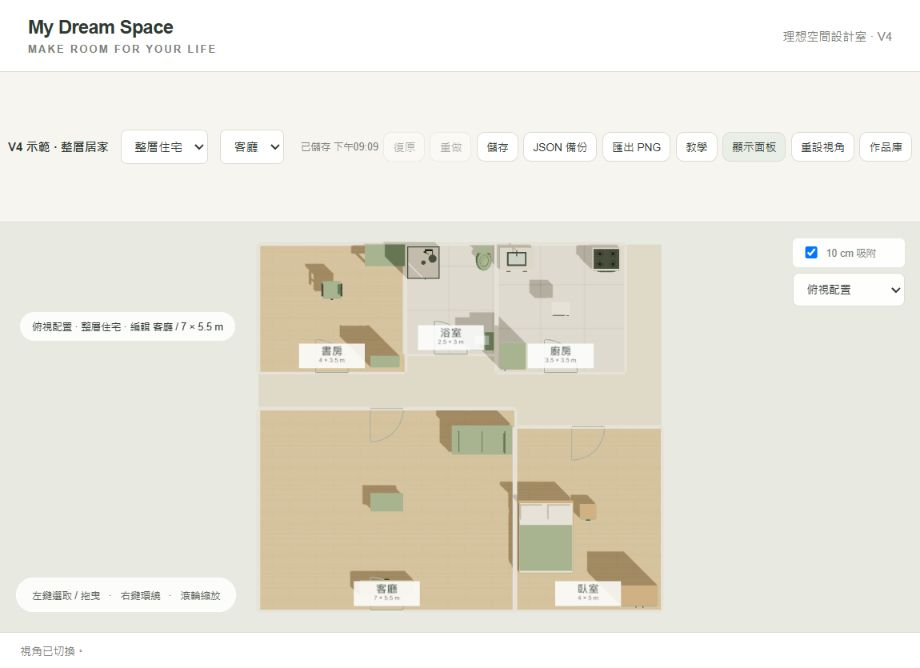
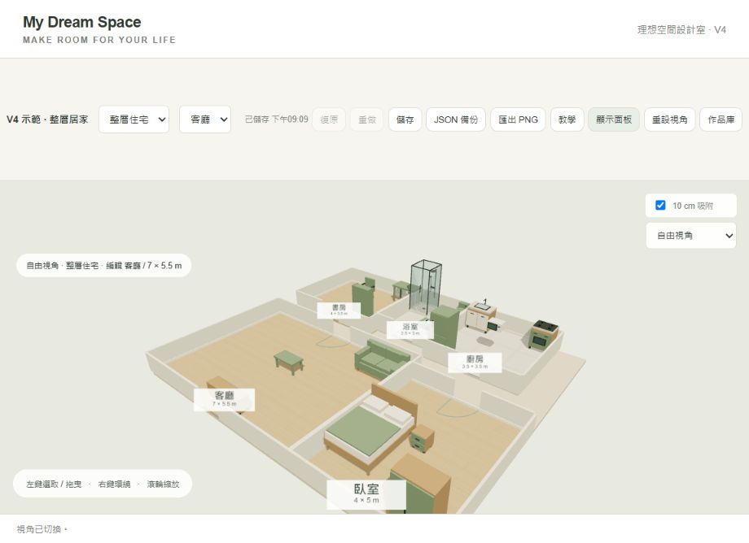

# My Dream Space｜3D 理想空間設計模擬器

V4 本機版。以 Three.js 程序化模型設計理想居住空間，可選家具、修改裝潢、管理預算並保存多個作品。

## GitHub 上傳與作業使用

解壓縮交付 ZIP，把**裡面的檔案與資料夾**上傳到你選定的 GitHub 儲存庫根目錄；不要只上傳 ZIP，也不要讓 index.html 多包在一層資料夾內。

網站正式執行只需要根目錄的 **index.html**。其餘檔案用於說明、開發歷史、截圖與測試，網頁不依賴它們。程式只從固定版本 CDN 載入 Three.js，沒有後端、帳號、API Key、外部貼圖／模型或 npm build。

設定 GitHub Pages 的詳細步驟見 [發布指南](docs/GitHub-Pages-發布步驟.md)。目前**沒有已發布的公開網址**；部署成功後，請把實際網址與公開網址驗收結果追加到 DEVELOPMENT_LOG.md，勿將 localhost 當作繳交網址。

課堂作業資料可使用：

- [完整 Vibe Coding 開發與修改紀錄](DEVELOPMENT_LOG.md)
- [原始規格書](docs/My_Dream_Space_規格書.md)
- [原始開發 Prompt](docs/My_Dream_Space_Codex_Prompt.md)
- [V3 修改與測試紀錄](docs/V3-修改與測試紀錄.md)
- [V4 修改與測試紀錄](docs/V4-修改與測試紀錄.md)
- docs/screenshots/ 中實際保存的介面截圖與圖片。

## 現有功能

- 四場景：宿舍、套房、臥室、自己的房子。套房有主房／浴室／廚房；房子以五個空間與連接走道呈現整層住宅，也可逐房查看。
- 58 種家具與物品，包含 12 種衛浴、8 種廚房與更多裝飾。淋浴間有頂噴、手持頭、軟管、玻璃門與排水口。
- 選取、拖曳、旋轉、複製、刪除、家具顏色、10 cm 吸附與重疊提醒。
- 各房間尺寸、牆色、地板、環境燈光與主題；共用專案預算，附贈家具免費、複製計價。
- 作品庫、本機自動保存、50 步復原／重做、JSON 備份／匯入、房間或整層 PNG、新手教學。
- 自由、正交俯視與受限制的室內視角；專注設計模式。





## 本機開啟

用任一靜態 HTTP 伺服器提供本資料夾。例如已安裝 Python 時：

```sh
python -m http.server 8765 --bind 127.0.0.1
```

再開啟 http://127.0.0.1:8765/ 。不需要安裝 Node 或執行 build 才能使用網站。此指令只是本機預覽方式，正式 GitHub Pages 不需要 Python。

桌機 Chrome／Edge 與可存取 CDN 的網路為主要試用環境。直接雙擊 HTML 未作為歷史瀏覽器驗收方式。

作品存在**當前瀏覽器與網址的 localStorage**，不包含在這個程式套件。要把設計搬到 GitHub Pages，在本機作品庫按「備份作品庫」或在編輯器按「JSON 備份」，再於公開網站匯入。

## 檔案配置

```text
index.html                  唯一正式網頁入口
README.md                   功能、上傳與試用說明
DEVELOPMENT_LOG.md          持續追加的完整開發紀錄
AGENTS.md                   後續 AI 協作與紀錄規則
docs/                       規格、Prompt、發布指南、分版紀錄
docs/screenshots/           實際保存的截圖與輸出圖片
history/versions/           V1–V4 來源文字快照（.html.txt）
history/scripts/            當時留下的開發修改腳本
history/README.md           快照與腳本的來源及限制
tests/                      保存的 V3／V4 資料測試
FILE_MANIFEST.sha256        各檔案完整性雜湊
```

沒有 V2 截圖檔；不補造不存在的圖片。歷史腳本不屬網站啟動步驟，也不是一套已完整驗證的自動重建流程。

## 驗證與已知限制

瀏覽器已測試 58 種家具新增／選取／刪除、尺寸復原與重做、跨房間拖曳、整層與單房顯示、JSON 往返與 PNG 下載。詳細數值、當時版本與測試障礙見 DEVELOPMENT_LOG.md。

若要執行保存的資料測試，在儲存庫根目錄使用 Node.js：

```sh
node tests/test-v3.cjs
node tests/test-v4.cjs
```

這些測試不需安裝套件；V3 測試讀歷史 V3 文字快照，V4 測試讀目前 index.html。它們是資料與錯誤處理測試，**不是瀏覽器或 WebGL 渲染測試**。

仍待驗證：真實手機、全部顯示卡、壓力與真實故障情境、GitHub Pages 公開 HTTPS 網址。現行整層房間排列固定；沒有自由隔間、門窗搬動、完整漫遊、物品自動吸附表面或多分頁衝突合併。

## 本次文件交付檢查

2026-10-14 的文件整理沒有新增產品功能或瀏覽器測試。已確認成品雜湊未變、V1–V4 快照語法檢查通過、V3／V4 保存的資料測試可從套件根目錄執行、文件內本機連結存在；ZIP 與各檔案雜湊由打包程序核對。產品整理前 SHA-256：

```text
BCC656423F16365650AA3FF0D15A9716FF60962F60014C5AC9DC99F44964B52D
```
